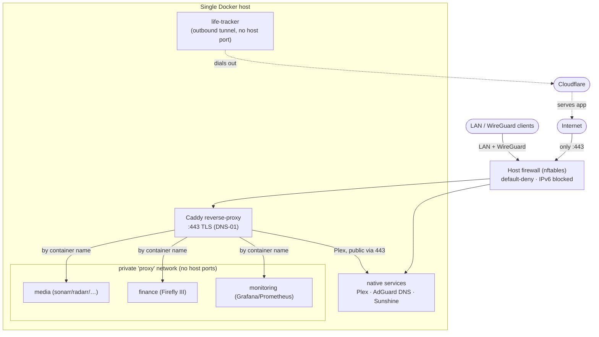

# Self-Hosted Homelab — Architecture & Security Showcase

A reference write-up of a single-host, Docker-based homelab: ~40 containerised
services behind a single TLS reverse-proxy, a default-deny host firewall, and an
infrastructure-as-code layout where every stack is a plain `docker compose` file.

> **Anonymised.** All domains, IP addresses, prefixes, usernames and secrets in this
> repository are placeholders (`home.example`, `192.168.1.0/24`, `2001:db8::/64`, …).
> It documents *architecture and method*, not a live deployment.

---

## Highlights

- **Single public ingress.** Exactly one port faces the internet: `443` on a Caddy
  reverse-proxy with automatic TLS. Every other service has **no host-published port**.
- **Default-deny firewall.** nftables host firewall, all unsolicited inbound dropped,
  **all inbound IPv6 blocked** at the edge while the kernel stack stays enabled.
- **Private service mesh.** Services reach each other and the proxy over an internal
  Docker network by container name — nothing is bound to `0.0.0.0`/`[::]`.
- **Defence in depth.** Public TLS via DNS-01, admin UIs gated to LAN + WireGuard,
  secrets kept out of compose files in `chmod 600` env files.
- **IaC + reproducible.** Each stack is a self-contained `docker-compose.yml`; bring any
  of them up with one command.

## Architecture



See **[docs/architecture.md](docs/architecture.md)** for the network design and
**[docs/security-hardening.md](docs/security-hardening.md)** for the hardening case study.

## Tech stack

| Layer | Tooling |
|---|---|
| Reverse proxy / TLS | Caddy (Cloudflare DNS-01 wildcard certs) |
| Firewall | nftables (systemd-managed) |
| Remote access | WireGuard (router-terminated), SSH (keys-only, non-standard port, fail2ban) |
| Orchestration | Docker + Docker Compose (one stack per directory) |
| Observability | Prometheus, Grafana, cAdvisor, node_exporter, blackbox, Uptime-Kuma |
| Media | Sonarr, Radarr, Prowlarr, Bazarr, Lidarr, Tautulli, Overseerr |
| Media server | Plex (native; reachable from outside only via Caddy :443) |
| DNS | AdGuard Home (LAN DNS with local rewrites) |
| Game streaming | Sunshine / Moonlight (over WireGuard) |
| Tunneled apps | Cloudflare Tunnel (outbound-only — see `stacks/life-tracker`) |
| Data | PostgreSQL, MariaDB, Redis |

## Repository layout

```
.
├── docs/
│   ├── architecture.md          network & reverse-proxy design
│   └── security-hardening.md     the hardening case study (before → after)
├── firewall/
│   ├── fw_home.nft               nftables ruleset (anonymised)
│   └── fw-home.service           systemd unit for persistence
├── edge/
│   ├── docker-compose.yml        Caddy + the published :443 ingress
│   ├── Caddyfile                 vhost + LAN/WireGuard gating pattern
│   └── .env.example
└── stacks/
    ├── media-arr/                reverse-proxied media stack (no host ports)
    ├── finance/                  Firefly III + internal MariaDB
    ├── life-tracker/             Cloudflare-tunnel app (zero inbound ports, hardened container)
    └── monitoring/               Prometheus + Grafana
```

## The core pattern

Every service follows the same shape — **no published port**, joined to a shared
internal network, reached only through the proxy:

```yaml
services:
  app:
    image: example/app:1.0.0
    # note: NO "ports:" — not published to the host at all
    networks: [internal, proxy]   # proxy = shared external net Caddy lives on
networks:
  internal:
  proxy:
    external: true
```

```caddyfile
app.home.example {
    reverse_proxy app:8080          # by container name, over the private network
}
```

## Hardware

Single node: Debian, Ryzen 7 3700X (8c/16t), 64 GB RAM, RTX 3070 (transcoding +
compute), ~8 TB storage, on a UPS.

## Related

The public metrics API that backs the "Lab" page is documented in the portfolio
repository (its `docs/` + `api/`), kept as the single source of truth rather than
duplicated here.

## License

MIT — see [LICENSE](LICENSE).
