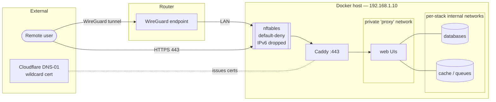

# Architecture

> Anonymised. `home.example`, `192.168.1.0/24`, `10.100.0.0/24`, `2001:db8::/64` are placeholders.

## Network design



## Design principles

1. **One ingress.** Only Caddy's `443` is published. Everything else is unpublished and
   lives on private Docker networks.
2. **Name-based routing.** Caddy and each backend share an external `proxy` network;
   Caddy proxies to `container-name:port`. Backends never bind a host interface.
3. **Per-stack isolation.** Each stack has its own `internal` network for its databases and
   brokers; only the stack's web component also joins `proxy`.
4. **Two trust zones.** A handful of public hostnames (e.g. media requests) vs. admin UIs
   gated to LAN + WireGuard source ranges inside the proxy config.
5. **Secrets outside compose.** Compose files are safe to commit; secrets live in
   `.env`/`stack.env` files (`chmod 600`, git-ignored).

## Trust zones in the proxy

```caddyfile
*.home.example {
    tls { dns cloudflare {env.CLOUDFLARE_API_TOKEN} }

    # Public (app handles its own auth)
    @public host requests.home.example
    handle @public { reverse_proxy overseerr:5055 }

    # Gate: everything below = LAN + WireGuard only
    @outside not remote_ip 192.168.1.0/24 10.100.0.0/24
    abort @outside

    @admin host grafana.home.example
    handle @admin { reverse_proxy grafana:3000 }
    # … more admin vhosts …
}
```

## Reverse-proxy migration pattern

Moving a service from "published on the host" to "private, proxy-only":

1. `docker inspect` the running container for image, env, mounts, internal port.
2. Write a `docker-compose.yml` with the same image/env/volumes, **no `ports:`**, on the
   `internal` + `proxy` networks. Reuse existing named volumes (`external: true`) so data
   is preserved.
3. Replace the proxy upstream from `host-ip:port` to `container-name:internal-port`.
4. Recreate the service, reload the proxy, verify the hostname + any internal links.

The result: nothing on the host, access only through the TLS proxy.

## Two ways in

Services reach the outside through one of two patterns, both of which keep inbound host
ports at zero (except Caddy's `443`):

- **Reverse-proxy (Caddy `:443`)** — the default. TLS terminates at Caddy; backends are
  private and reached by container name. Used for the media, finance and monitoring stacks.
- **Outbound tunnel (Cloudflare)** — `cloudflared` dials out from inside the host and serves
  an app through the tunnel, so there is **no inbound port at all**, not even `443`. Used for
  the life-tracker app (`stacks/life-tracker`), whose container is additionally hardened:
  read-only rootfs, all capabilities dropped, no privilege escalation, non-root user.

## Native (non-container) services

A few services run natively on the host rather than in Docker. They sit behind the same
firewall and are never directly internet-exposed:

- **Plex** — reachable from outside only *through* Caddy on `443`; its own port is LAN-only.
- **AdGuard Home** — LAN DNS with local rewrites; `:53` stays on the host for LAN clients.
- **Sunshine / Moonlight** — desktop/game streaming, reached over **WireGuard**, not the
  public internet.

Remote administration is over **WireGuard** (terminated at the router) plus SSH; the proxy's
`@outside` gate and the firewall both scope admin access to LAN + WireGuard ranges.
